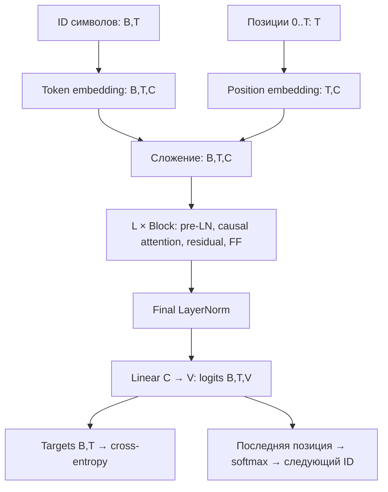

# 253 · Строим GPT на Rust: от bigram до генерации Шекспира

Перенос [урока Андрея Карпаты ng-video-lecture](https://github.com/karpathy/ng-video-lecture) на Rust. Мы обучаем модель с нуля: сначала таблицу bigram, затем decoder Transformer с несколькими головами внимания. В конце он продолжает текст, предсказывая по одному следующему символу.

В [уроках 247](../l247-52-generate-names-with-makemore-mlp/README.md) и [249](../l249-54-makemore-batch-normalization/README.md) контекст обрабатывал MLP. Здесь позиции обмениваются информацией через causal self-attention. Знакомое кодирование `sorted(unique(chars)).enumerate()` сохраняется: в этом оригинальном уроке один токен — один символ. BPE и SentencePiece из уроков 251–252 здесь не нужны, чтобы изучить сам Transformer.

## Быстрый запуск

Из корня репозитория:

```bash
# Только данные, сдвиг targets и три способа усреднить прошлое:
cargo run --release -p l253-58-build-gpt-from-scratch -- --demo-only

# Начальная bigram-модель, 1000 обновлений:
cargo run --release -p l253-58-build-gpt-from-scratch -- --model bigram

# Полноценный маленький GPT, 500 обновлений на CPU:
cargo run --release -p l253-58-build-gpt-from-scratch

# Очень короткий запуск всего пути: данные -> обучение -> генерация:
cargo run --release -p l253-58-build-gpt-from-scratch -- --preset smoke --generate 80

cargo test --locked -p l253-58-build-gpt-from-scratch
```

Из папки урока можно выполнить `cargo run --release`. Требуется Rust с поддержкой edition 2024. Python, PyTorch, CUDA и скачивание весов не нужны. Первая сборка скачивает зависимости Candle; Tiny Shakespeare уже лежит в `data/input.txt`. После сборки запуск работает без сети. Оптимизированная сборка важна для времени обучения.

При проверке на Ryzen 5 7600 smoke занял меньше секунды, маленький GPT — около 26 секунд вместе с генерацией 500 символов; первая сборка не включена. На другом CPU время будет другим. Фактические loss и примеры текста приведены в [RESULTS.md](RESULTS.md).

### Что находится в коде

| Файл | Что читать |
|---|---|
| [main.rs](src/main.rs) | Вход в урок, словарь, пример x/y, демонстрация внимания |
| [data.rs](src/data.rs) | Символы ↔ ID, train/val, случайные batch |
| [model.rs](src/model.rs) | Linear, Embedding, LayerNorm, Head, MultiHeadAttention, FeedForward, Block, Gpt, loss |
| [train.rs](src/train.rs) | Пресеты, AdamW, оценка loss, sampling, цикл обучения |
| [rng.rs](src/rng.rs) | Воспроизводимые случайные числа |

Candle здесь играет роль тензоров и autograd из PyTorch. Готовой GPT из библиотеки нет: все слои и их соединения видны в `model.rs`. Матрицы — `Tensor`, обучаемые переменные — `Var`. Мы не пишем вручную производную каждого матричного умножения: Candle строит граф и выполняет backward. Масштабирование attention, нормализация, mask и dropout заданы явно.

## 1. Что именно предсказывает модель

Возьмём строку `hello`. Если окно длины 4, вход `x=hell`, правильные следующие символы `y=ello`:

| Позиция t | Доступный контекст | Следующий символ y[t] |
|---|---|---|
| 0 | h | e |
| 1 | he | l |
| 2 | hel | l |
| 3 | hell | o |

Один forward решает все четыре задачи одновременно. При этом в памяти лежит весь `x`: именно **маска внимания** не даёт позиции 0 подсмотреть позиции 1–3. Позиция может смотреть на себя: из текущего символа мы предсказываем следующий.

`Vocabulary` сортирует уникальные `char` и назначает ID. Это числа-индексы, а не величины: ID 40 не означает «в два раза больше», чем ID 20. В нашем корпусе 65 символов; ID 0 обозначает перевод строки. `encode` и `decode` проверяют неизвестные символы и индексы. В этом английском словаре нет русских букв.

Полный текст содержит 1 115 394 символа. Как в оригинале, первые 90% — train, последние 10% — validation. В `batch` сначала выбирается split, затем начало каждого окна; окно и сдвинутый на один символ target целиком остаются в выбранном split. В отличие от перемешивания отдельных символов, это сохраняет язык и границу проверки. Сам алфавит строится по полному тексту, как в исходном уроке; validation здесь не является проверкой неизвестного алфавита.

Обозначения для последующих форм:

- `B` — число независимых окон в batch.
- `T` — длина каждого окна; не больше `block_size`.
- `V` — размер словаря, здесь 65.
- `C` — ширина вектора позиции, `n_embd` в Python.
- `H` — число голов, `D=C/H` — ширина одной головы.
- `L` — число Transformer-блоков.

У ID и targets форма `(B,T)`, dtype `u32`. У признаков и параметров dtype `f32`.

## 2. Bigram: самая простая обучаемая языковая модель

Запусти `--model bigram`. Единственный параметр — таблица `(V,V)`. Текущий символ выбирает строку, а её V значений — logits следующего символа. Например, строка для `h` учится повышать оценку `e`.

`logits` — ещё не вероятности: они могут быть любыми вещественными числами. Softmax превращает строку в распределение:

```text
p[j] = exp(logit[j] - max(logits)) / sum(exp(logits - max(logits)))
loss одной позиции = -ln(p[правильный следующий символ])
```

В `loss` объединяем B и T: `(B,T,V)` → `(B*T,V)`, targets `(B,T)` → `(B*T)`. Cross-entropy усредняется по всем B*T позициям. До обучения равномерные вероятности дают `ln(65) ≈ 4.1744`. Чем выше вероятность правильного символа, тем меньше loss. Вычитаем максимум для устойчивости вычисления; вероятности от этого не меняются. В коде используется `candle_nn::loss::cross_entropy` со стабильным log-softmax, перед ним отдельный softmax не нужен.

Проблема bigram: для `h` после `t` и для `h` после `c` она выдаст одну и ту же строку. Она не использует предыдущие буквы, хотя принимает целое окно. Сгенерированный текст подхватывает частые пары, но не умеет согласовывать длинные фрагменты.

Для сравнения с необученной моделью:

```bash
cargo run --release -p l253-58-build-gpt-from-scratch -- --model bigram --steps 0 --generate 200
```

## 3. Первый обмен информацией: среднее прошлого

Хотим, чтобы вектор позиции содержал сведения о предыдущих позициях. Начнём с равномерного усреднения. Для чисел `[1,2,3,4]`:

```text
позиция 0: 1                   = 1.0
позиция 1: (1+2)/2             = 1.5
позиция 2: (1+2+3)/3           = 2.0
позиция 3: (1+2+3+4)/4         = 2.5
```

То же самое — матричное умножение:

```text
[1    0    0    0  ]   [1]   [1.0]
[1/2  1/2  0    0  ] × [2] = [1.5]
[1/3  1/3  1/3  0  ]   [3]   [2.0]
[1/4  1/4  1/4  1/4]   [4]   [2.5]
```

Каждая строка — веса источников для одной позиции. Выше диагонали нули: будущее запрещено. `demonstrate_attention` вычисляет это циклом, прямой матрицей и masked softmax нулевых scores. Все способы дают одинаковый результат. Этот шаг помогает увидеть, что attention — взвешенная передача информации между позициями.

Равномерное среднее слишком грубое: иногда важна соседняя буква, иногда начало слова. Поэтому следующий шаг — **обучаемые веса, зависящие от содержимого**.

## 4. Одна голова self-attention: Q, K, V

На входе `x` формы `(B,T,C)`. Три обучаемые линейные проекции без bias дают:

```text
Q = x Wqᵀ   (B,T,D)   что эта позиция ищет
K = x Wkᵀ   (B,T,D)   по каким признакам позицию можно найти
V = x Wvᵀ   (B,T,D)   какую информацию позиция передаст
```

Для позиции t считаем скалярное произведение её query с key каждой позиции s. Получаем scores `(B,T,T)`. Первый T — получатели, второй T — источники:

```text
scores[t,s] = sum_d(Q[t,d] * K[s,d]) / sqrt(D)
A[t,:] = softmax(scores[t,:] + causal_mask[t,:])
out[t,:] = sum_s(A[t,s] * V[s,:])
```

Например, query `[1,0]` сильнее совпадает с key `[2,0]`, чем с `[0,1]`: до масштабирования scores равны 2 и 0. Softmax даст первому больший вес. Сами признаки не назначены вручную значениям «буква», «слово» или «подлежащее» — они меняются при обучении ради уменьшения next-token loss.

Деление на `sqrt(D)` сдерживает рост разброса scores при увеличении числа координат. Иначе softmax легко становится почти выбором одной позиции и получает слишком слабые градиенты.

### Как запретить будущее

`causal_mask(T)` содержит 0 на диагонали и ниже, `-∞` выше. Маска прибавляется **до softmax**. `exp(-∞)=0`, поэтому будущие позиции получают вероятность 0. Нулевое значение score будущее не запрещает: `exp(0)=1`.

При нулевых Q и K все разрешённые scores одинаковы. Получается равномерное среднее из предыдущего раздела. При обученных Q/K распределение уже зависит от контекста. Функция `attention_weights` — это весь расчёт от Q/K до матрицы A; `Head::forward` умножает её на V.

Здесь только self-attention: Q/K/V получены из одного x. Отдельного encoder и cross-attention нет.

## 5. Несколько голов и feed-forward

Одна голова сжимает C признаков до D. `MultiHeadAttention` запускает H независимых голов с собственными Wq/Wk/Wv, склеивает результаты по координатам и применяет выходную проекцию:

```text
H × (B,T,D) -> concatenate -> (B,T,H*D) = (B,T,C)
                                 -> Linear(C,C) -> dropout
```

Головы могут выучить разные способы связывать позиции. Это разные наборы параметров, а не повторение одной и той же головы. Конфигурация проверяет `C % H == 0`.

Attention передаёт информацию между позициями. `FeedForward` затем преобразует признаки каждой позиции отдельно:

```text
(B,T,C) -> Linear(C,4*C) -> ReLU -> Linear(4*C,C) -> dropout
```

Одинаковые веса FF применяются ко всем позициям. FF не видит соседние позиции напрямую: перед ним сведения о соседях собрал attention. ReLU оставляет положительные значения и обнуляет отрицательные; без нелинейности две линейные проекции можно было бы свернуть в одну.

## 6. Residual, LayerNorm и dropout

Один `Block` выполняет:

```text
x = x + MultiHeadAttention(LayerNorm1(x))
x = x + FeedForward(LayerNorm2(x))
```

Это residual-связи: слой учится добавке к текущему представлению. Прямой путь помогает информации и градиентам проходить через несколько блоков. Формы обеих ветвей обязаны совпадать `(B,T,C)`.

LayerNorm перед подслоем — схема **pre-norm**, как в оригинале. Для каждой отдельной позиции берём среднее и дисперсию по C координатам:

```text
normalized = (x - mean_C(x)) / sqrt(mean_C((x-mean_C(x))²) + 1e-5)
output = normalized * gain + bias
```

Дисперсия делится на C, а не C−1. `gain` и `bias` обучаются, изначально равны 1 и 0. В отличие от BatchNorm из урока 249 здесь нет среднего по batch, running statistics и смешивания позиций времени. Нормировка по времени могла бы открыть путь к будущим токенам; по C она этого не делает.

Dropout в train случайно обнуляет долю p значений, остальные делит на `1-p`. Он стоит после softmax внимания, после выходной проекции голов и после FF. Поэтому **после dropout** строки внимания уже не обязаны суммироваться в 1. В eval и генерации dropout выключен. В этом переносе режим задаётся аргументом `train`, вместо переключения `model.train()/eval()`.

## 7. Собираем GPT



Token embedding — таблица `(V,C)`: каждому ID соответствует обучаемый вектор. Position embedding — другая таблица `(block_size,C)`. Позиция 3 получает свою строку независимо от того, какой там символ. Складываем два вектора, не склеиваем: ширина остаётся C.

Затем идут L блоков, финальная LayerNorm и линейная проекция из C в V. В отличие от bigram logits теперь зависят от всего разрешённого префикса. Это decoder-only, GPT-подобная модель на символах: не ChatGPT, не инструкциям обученный ассистент и не предобученная модель.

Веса Linear и Embedding инициализируются `N(0,0.02²)`, bias — нулями; это соответствует `_init_weights` в зафиксированном `gpt.py`. Вес выходной проекции и token embedding отдельные: weight tying в этом оригинале нет. Наш tiny GPT имеет 110 145 параметров, оригинальный размер — 10 788 929.

## 8. Backward и AdamW

Цикл `train::run` выполняет ровно `steps` обновлений:

1. Выбрать независимые окна из train.
2. Выполнить forward с dropout.
3. Посчитать среднюю next-token cross-entropy по всем позициям.
4. `loss.backward()` вычисляет градиенты всех участвующих параметров.
5. AdamW меняет их и переходит к следующему batch.

В коде шаги 4–5 объединяет `optimizer.backward_step`. `Parameters` хранит `Var`; слои читают те же переменные как тензоры. Мы не преобразуем признаки в `Vec` внутри forward: это разорвало бы граф. В `Vec` переводятся только демонстрации, scalar loss и финальные logits для sampling.

AdamW ведёт скользящие средние градиента и его квадрата, корректирует их начальное смещение, масштабирует шаг по координатам и отдельно уменьшает веса (weight decay). Используются beta1=0.9, beta2=0.999, eps=1e-8, weight_decay=0.01 для всех параметров, как при `torch.optim.AdamW(model.parameters(), lr=...)` в исходнике. Расписание learning rate и gradient clipping в этом уроке не добавлены.

В Candle каждый backward возвращает новый `GradStore`, а не накапливает `.grad` в параметрах. Поэтому отдельного `zero_grad` из PyTorch нет. Новый forward создаёт новый граф.

### Как читать train и validation loss

В точке 0 и после выбранного числа обновлений `estimate` усредняет loss по нескольким окнам каждого split. Для этой оценки параметры отсоединяются через `detach`, dropout отключён. Backward и optimizer не вызываются.

Окна оценки фиксированы seed: сравнение соседних checkpoints меньше зависит от случайного выбора текста. RNG оценки, batch обучения, dropout и генерации разделены, поэтому изменение `--eval-every` не меняет будущие обучающие batch. Это выбранная для наглядности разница с общим RNG в Python.

Train и val — средние на выбранных окнах, не точный проход всего корпуса. Val иногда может быть ниже train: окна имеют разную сложность. Если train долго снижается, а val растёт, модель может переобучаться. Validation используется для наблюдения и выбора настроек; отдельного независимого test здесь нет, как и в исходном уроке.

## 9. Авторегрессионная генерация

`generate` начинает с prompt (по умолчанию `[0]`, то есть перевод строки). На каждом шаге:

1. Оставить последние `block_size` ID: длинный текст не помещается в positional embedding целиком.
2. Получить logits, взять только последнюю позицию `(V)`.
3. Превратить оценки в вероятности с temperature=1.
4. Случайно выбрать один ID по этому распределению и дописать к тексту.
5. Повторить с обновлённым контекстом.

Это sampling, а не argmax: даже не самая вероятная буква иногда выбирается. Поэтому seed влияет на конкретный текст. В train следующая буква уже известна из корпуса (teacher forcing); в генерации мы подаём собственный предыдущий выбор, и ошибки могут накапливаться.

При обрезании окна позиции снова нумеруются `0..T-1`, как в `gpt.py`. KV-cache не реализован: окно пересчитывается каждый раз. Полный сгенерированный текст сохраняется, обрезается только вход модели.

```bash
cargo run --release -p l253-58-build-gpt-from-scratch -- --steps 2000 --eval-every 500 --prompt 'ROMEO:' --generate 500
```

Передавай только символы из напечатанного словаря. Пустой prompt и отсутствующие символы вызывают ошибку. `--steps 0` означает генерацию из случайно инициализированной модели, а не загрузку обученных весов. Каждый запуск обучает заново; сохранение checkpoint не входит в исходный урок и здесь не добавлено.

## 10. Размеры и соответствие оригиналу

| GPT preset | B | T | C | H | L | dropout | steps | lr | eval batches |
|---|---|---|---|---|---|---|---|---|---|---|
| smoke | 2 | 8 | 16 | 2 | 1 | 0.2 | 20 | 0.003 | 2 |
| tiny (по умолчанию) | 8 | 32 | 64 | 4 | 2 | 0.2 | 500 | 0.001 | 10 |
| lecture | 64 | 256 | 384 | 6 | 6 | 0.2 | 5000 | 0.0003 | 200 |

Для bigram в tiny: B=32, T=8, steps=1000, lr=0.01. В lecture bigram: B=32, T=8, steps=3000, eval interval=300, eval batches=200 — параметры `bigram.py`. C/H/L/dropout для bigram не используются. В smoke bigram размеры batch и окна уменьшены так же, как у smoke GPT.

`--steps`, `--eval-every` и `--eval-batches` заменяют значения пресета независимо от порядка аргументов. `--generate`, `--prompt`, `--seed` управляют генерацией и воспроизводимостью. Все параметры можно увидеть через `--help` и в заголовке запуска.

Полный размер оригинального GPT:

```bash
cargo run --release -p l253-58-build-gpt-from-scratch -- --preset lecture
```

Этот режим также работает на CPU, а исходник выбирает CUDA, если она доступна. Время и память полного размера существенно больше tiny: в каждой голове хранится матрица внимания `(B,T,T)`, для backward нужны промежуточные значения всех блоков. Полные 5000 обновлений lecture здесь не выполнялись; проверены построение модели, число параметров и короткий forward оригинального размера. Проверки обучения и численные результаты выполнены для tiny/smoke. Размер пресета не обещает одинаковых с Python чисел: RNG, порядок инициализации и вычислительные ядра разные.

| В Python | В Rust |
|---|---|
| `nn.Embedding` | `Embedding` / `index_select` |
| `nn.Linear` | `Linear` / matmul и bias |
| `nn.LayerNorm` | `LayerNorm` через mean, variance и affine |
| `Head` | `Head`, те же Q/K/V без bias |
| `MultiHeadAttention`, `FeedFoward`, `Block` | Одноимённые этапы, FF исправлено на `FeedForward` |
| `GPTLanguageModel` | `Gpt` и `LanguageModel::Gpt` |
| `model.eval()` + `no_grad()` | `train=false` + отсоединённые параметры |
| `loss.backward(); optimizer.step()` | `optimizer.backward_step(&loss)` |
| `torch.multinomial` | Seeded categorical sampling |

В bigram веса у нас тоже `N(0,0.02²)`, тогда как начальный `nn.Embedding` в `bigram.py` имеет стандартное отклонение 1. Это явное отличие начального baseline; формула модели и обучения сохраняется. Основная GPT-архитектура соответствует финальному `gpt.py` указанного commit. Происхождение данных и авторство: [SOURCE.md](data/SOURCE.md), [NOTICE.md](NOTICE.md).

## 11. Что проверяется

Тесты выполняют настоящие forward/backward и обновления весов:

- Кодирование Unicode и обратное преобразование; сдвиг targets; окна не выходят из своего split.
- Causal weights равны нулю для будущего, нормированы до dropout и дают ожидаемые средние.
- Замена будущих ID не меняет logits предыдущих позиций полного многослойного GPT.
- Все группы параметров получают конечные ненулевые градиенты; eval отсоединён от параметров.
- Градиент attention по Q совпадает с центральной конечной разностью в f64.
- LayerNorm работает по C; dropout воспроизводим и выключен в eval.
- Cross-entropy для нулевых logits равна ln(V); bigram не зависит от раннего контекста.
- Полный маленький GPT обучается на повторяющейся последовательности до loss <0.15.
- Генерация воспроизводится, сохраняет prompt и работает дольше размера окна.
- Оригинальный размер имеет 10 788 929 параметров и выполняет короткий forward.

Полный workspace содержит отдельный CUDA-урок, поэтому для этого CPU-урока достаточно указанного `cargo test -p ...`; GPU не нужен.

## 12. Практика и самопроверка

1. Вручную запиши x/y для `hello`. Почему на позиции 0 нельзя видеть x[1], даже если весь x уже загружен?
2. Найди в коде маску. Мысленно замени `-∞` на 0: как изменятся веса? Тест причинности должен ловить утечку будущего.
3. Объясни формы Q, K, scores, A, V и AV для tiny: B=8, T=32, C=64, H=4.
4. Почему матрица внимания зависит от текста, а параметры Wq/Wk/Wv остаются одними и теми же для разных текстов?
5. Сравни bigram и GPT после одинакового числа обновлений. Затем учти разное время и число параметров: эти сравнения отвечают на разные вопросы.
6. Увеличь `--steps` до 2000. Сохрани train/val loss и генерацию; проверь, стали ли лучше отдельные слова и остаются ли ошибки смысла.
7. В `Settings` сделай C=32, H=4 и L=1. Объясни, какие матрицы уменьшились и почему D стал 8.
8. Почему dropout должен быть выключен при сравнении loss? Почему LayerNorm не требует running statistics?
9. Почему это GPT-подобная модель, но не чат-ассистент? Какие данные и этапы обучения отсутствуют?

Готово, когда можешь проследить один batch от символов до loss и назад к обновлению весов, объяснить запрет будущего и самостоятельно показать цикл генерации из последней позиции.
